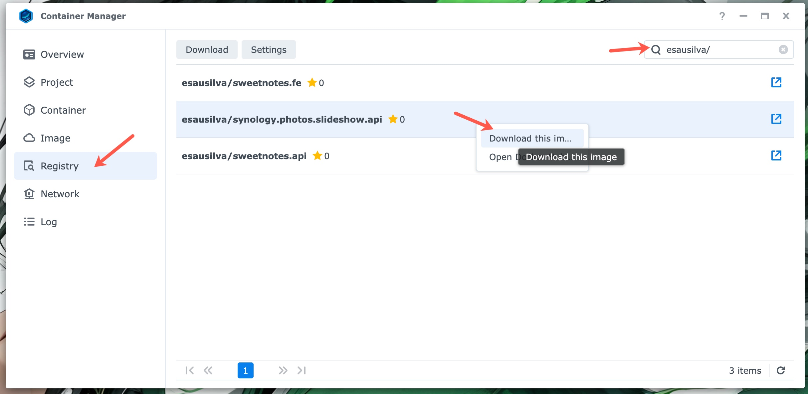
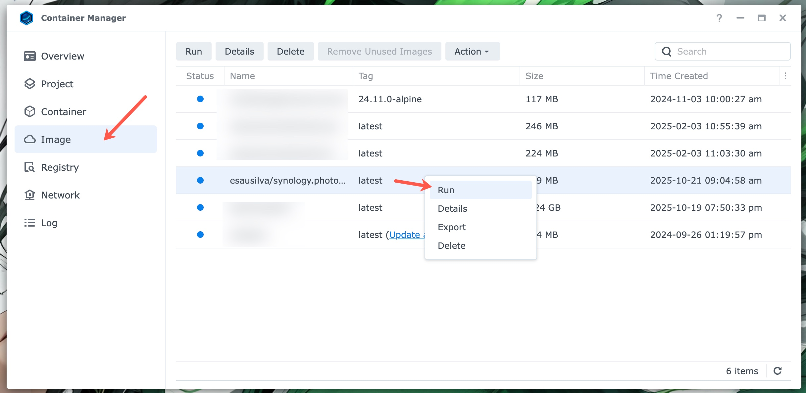

# Deployment To Your Synology NAS Device

## Docker Compose Project

Deploying via a Docker Compose Project is the recommended and simplest way to run the entire Synology Photos Slideshow suite on your NAS. Synology Container Manager includes built-in support for **Projects**, allowing you to deploy and manage multi-container applications from a single configuration.

This deployment uses two files provided in the repository:

- [`docker-compose.yaml`](../deployment/docker-compose.yaml) — Defines the multi-container stack, services, networks, volumes, and health checks.
- [`.env.example`](../deployment/.env.example) — A template file containing all environment variables and configuration options.

### Compose File Overview

The [`docker-compose.yaml`](../deployment/docker-compose.yaml) file defines three interconnected services under the `synology-photos-slideshow` project:

1. **`synology.photos.slideshow.api` (API Backend)**:
   - Runs the ASP.NET Core API (`esausilva/synology.photos.slideshow.api:latest`).
   - Exposes ports `5097` (HTTP) and `7078` (HTTPS).
   - Mounts two host volumes with read/write permissions:
     - `${SLIDES_VOLUME_PATH:-./.slides}` mapped to `/app/slides` (stores downloaded photos, WebP conversions, and thumbnails).
     - `${LOGS_VOLUME_PATH:-./.logs}` mapped to `/app/logs` (stores daily rolling API log files).
   - Configured through environment variables for NAS connection, photo library paths, scheduled downloads, and optional geolocation.
   - Depends on the `redis.slideshow` service being healthy before starting.

2. **`redis.slideshow` (Distributed Cache)**:
   - Runs `redis:8.6.0-alpine`.
   - Provides distributed caching for Google Maps geolocation lookups to speed up location queries and conserve API quotas.
   - Exposes port `6379`.
   - Mounts `${REDIS_DATA_PATH:-./.redis-data}` mapped to `/data` with persistence enabled (`redis-server --appendonly yes`).
   - Includes a health check (`redis-cli ping`) that checks every 5 seconds.

3. **`synology.photos.slideshow.client` (Web Client)**:
   - Runs the React 19 / TanStack Start frontend (`esausilva/synology.photos.slideshow.client:latest`).
   - Maps port `3500` on your NAS to port `3000` in the container. The slideshow UI will be accessible at `http://<YOUR-NAS-IP>:3500`.
   - Connects to the API via two environment variables:
     - `SERVER__API_BASE_URL`: Used by Nitro server functions for Server-Side Rendering (SSR). Defaults to internal container networking (`http://synology.photos.slideshow.api:5097`).
     - `CLIENT__API_BASE_URL`: Used by client-side browser requests and SignalR real-time connections (`http://<YOUR-NAS-IP>:5097`).
   - Depends on `synology.photos.slideshow.api`.

### Environment Configuration (`.env`)

To configure the project, copy [`.env.example`](../deployment/.env.example) to `.env` in the same directory as `docker-compose.yaml` and update the placeholder values for your environment.

| **Environment Variable** | **Value** | **Description** |
| ------------------------- | --------- | --------------- |
| `ASPNETCORE_ENVIRONMENT` | `Release` | ASP.NET Core hosting environment. |
| `UriBase__ServerIpOrHostname` | `<<SERVER_IP_OR_HOSTNAME>>` | IP address or hostname of your Synology NAS device. |
| `UriBase__Port` | `5000` | Port used by Synology DSM (default: `5000`). |
| `SynologyUser__Account` | `<<ACCOUNT>>` | Username for your Synology NAS account with photo access permissions. |
| `SynologyUser__Password` | `<<PASSWORD>>` | Password for your Synology NAS user account. |
| `SynoApiOptions__FileStationSearchFolders__0` | `/photo/Family` | Primary folder path on your NAS to search for photos. |
| `SynoApiOptions__FileStationSearchFolders__1` | `/photo/Vacation` | (Optional) Additional folder path on your NAS to search for photos. |
| `SynoApiOptions__NumberOfPhotoDownloads` | `10` | Number of random photos to download per batch (default: `10`). |
| `ThirdPartyServices__EnableGeolocation` | `false` | Enable Google Maps Geocoding API to resolve photo locations (`true`/`false`). |
| `ThirdPartyServices__EnableDistributedCache` | `true` | Enable Redis distributed cache to speed up photo location lookup (`true`/`false`). |
| `GoogleMapsOptions__ApiKey` | `<<GOOGLE_MAPS_API_KEY>>` | Google Maps API key (required if geolocation is enabled). |
| `PhotoDownloadScheduledJobOptions__Enabled` | `true` | Enable or disable the scheduled photo download job (`true`/`false`). |
| `PhotoDownloadScheduledJobOptions__DayOfWeek` | `0` | Day of the week to run the scheduled job (`0` = Sunday ... `6` = Saturday). |
| `PhotoDownloadScheduledJobOptions__Hour` | `12` | Hour of the day to run the scheduled job (24-hour format: `0`–`23`). |
| `PhotoDownloadScheduledJobOptions__Minute` | `3` | Minute of the hour to run the scheduled job (`0`–`59`). |
| `PhotoDownloadScheduledJobOptions__TimeZoneId` | `America/Chicago` | Valid IANA time zone ID for the scheduled job (e.g., `America/New_York`). |
| `FavoritesWatcherOptions__DebounceDelayInSeconds` | `10` | Seconds to wait before processing new photos placed in `favorites` (default: `10`). |
| `ConnectionStrings__Redis` | `redis.slideshow:6379,abortConnect=false,connectTimeout=10000` | Redis connection string pointing to the Redis service container. |
| `SLIDES_VOLUME_PATH` | `./.slides` | Host folder path on your NAS to store downloaded photos and thumbnails. |
| `LOGS_VOLUME_PATH` | `./.logs` | Host folder path on your NAS to store API rolling logs. |
| `REDIS_DATA_PATH` | `./.redis-data` | Host folder path on your NAS to persist Redis cache data. |
| `SERVER__API_BASE_URL` | `http://<<SERVER_IP>>:5097` | Internal API URL used by SSR server functions (Node.js context). |
| `CLIENT__API_BASE_URL` | `http://<<SERVER_IP>>:5097` | External API URL accessible by web browsers and SignalR on your local network. |

Refer to [Photo Location](./photo-location.md) and [Redis](./redis.md) for geolocation and caching details, including getting a Google Maps API key.

### Deploying the Project

1. **Prepare files on the NAS**:
   - Create a folder on your Synology NAS (for example, `/docker/synology-photos-slideshow` using File Station).
   - Place [`docker-compose.yaml`](../deployment/docker-compose.yaml) and your customized `.env` file in that folder.
   - (Optional) Create the host directories for your persistent data (such as `./.slides`, `./.logs`, and `./.redis-data`) and ensure appropriate read/write permissions.

2. **Deploy via Synology Container Manager**:
   - Open **Container Manager** on your Synology NAS.
   - Click on the **Project** tab in the left sidebar, then click **Create**.
   - Enter a **Project Name** (e.g., `synology-photos-slideshow`).
   - Set the **Path** to the folder where you placed `docker-compose.yaml` and `.env`.
   - Container Manager will detect the compose file. Click **Next**, review the settings, and click **Done**.
   - Container Manager will pull the images and start all three containers.

3. **Alternative: Deploy via SSH**:
   - If you have SSH access enabled on your NAS, navigate to the folder containing your files and run:
     ```shell
     docker compose --env-file .env up -d
     ```

Once deployed, access the slideshow web client at `http://<YOUR-NAS-IP>:3500`.

## Manual Setup via Container Manager GUI

Two options:

1. Download the latest image from my Docker Hub Repo: [esausilva/synology.photos.slideshow.api](https://hub.docker.com/r/esausilva/synology.photos.slideshow.api).
2. Build the image yourself and push it to your own Docker Hub repository. Following this route, you will need to rename the image to match your repository in the `docker-compose.yml` file. 

**For option 2:**

Build and push to Docker Hub:

```shell
docker-compose build
docker push [your-repo]/synology.photos.slideshow.api:latest
```

This will take the default docker compose file, `docker-compose.yaml`, and build the image, skipping the local docker compose file, `docker-compose.local.yml`.

**For both options:**

From Synology Container Manager, click on the "**Registry**" tab and search for the appropriate repository and image.

Right-click on the image and select "Download this image".



Once the image is downloaded, you can create a container from it by going to the "**Image**" tab, then right-clicking on the image, and selecting "**Run**".



From there, you can configure the container. In the first screen you will need to set the container name, I would suggest checking-off the "**Enable auto-restart**" option.

On the second screen, configure the local (to the NAS) ports. You can choose to use the default ports, or you can change them to whatever you want. Just be mindful that the API endpoint ports will need to match the ports you configure here.

Setting up volumes is optional, but I find them useful to be able to access the downloaded photos and logs. You will need to create the folders at your desired location in the NAS with File Station, then map them to the container by clicking the "**Add Folder**" button under the "**Volume Settings**" heading.

The volume maps in the container will  be `/app/slides` and `/app/logs`, make sure you assign Read/Write permissions to the volumes.

Finally, you need to configure the environment variables under the "**Environment**" heading.

The environment variables will be as follows:

| **Environment Variable**                  | **Value**                                                  |
| ----------------------------------------- | ---------------------------------------------------------- |
| ASPNETCORE_URLS                           | http://+:5097                                              |
| UriBase:ServerIpOrHostname                | [[SERVER_IP]]                                              |
| UriBase:Port                              | 5000                                                       |
| SynologyUser:Account                      | [[ACCOUNT]]                                                |
| SynologyUser:Password                     | [[PASSWORD]]                                               |
| SynoApiOptions:FileStationSearchFolders:0 | [[PATH_TO_PHOTOS_FOLDER_IN_NAS]]                           |
| SynoApiOptions:NumberOfPhotoDownloads     | 79                                                         |
| SynoApiOptions:DownloadAbsolutePath       | /app/slides                                                |
| ThirdPartyServices:EnableGeolocation      | true                                                       |
| ThirdPartyServices:EnableDistributedCache | true                                                       |
| GoogleMapsOptions:ApiKey                  | [[GOOGLE_MAPS_API_KEY]]                                    |
| PhotoDownloadScheduledJobOptions:Enabled    | true                                                       |
| PhotoDownloadScheduledJobOptions:DayOfWeek  | 0                                                          |
| PhotoDownloadScheduledJobOptions:Hour       | 12                                                         |
| PhotoDownloadScheduledJobOptions:Minute     | 3                                                          |
| PhotoDownloadScheduledJobOptions:TimeZoneId | America/Chicago                                            |
| FavoritesWatcherOptions:DebounceDelayInSeconds | 10                                                    |
| ConnectionStrings:Redis                   | [[SERVER_IP]]:6379,abortConnect=false,connectTimeout=10000 |

Refer to [Photo Location](./photo-location.md) and [Redis](./redis.md) for geolocation and caching, including getting the Google Maps API.
